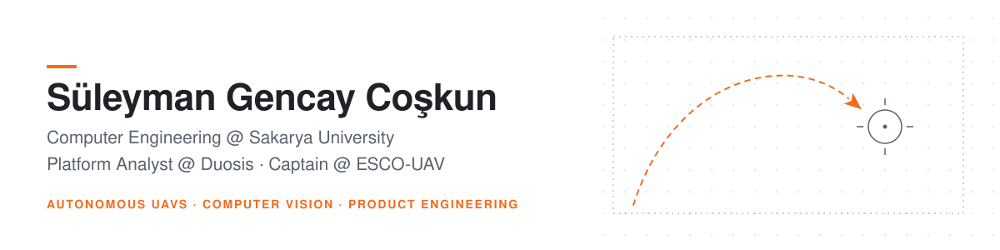
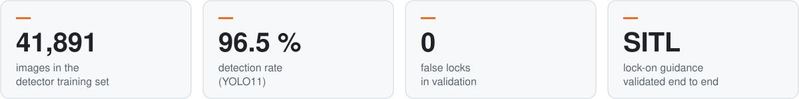
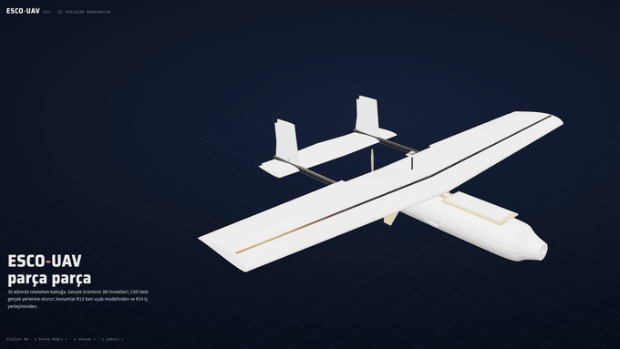
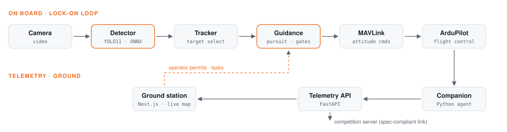
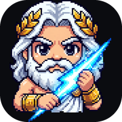
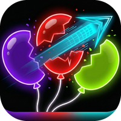
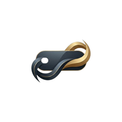

<picture>
  <source media="(prefers-color-scheme: dark)" srcset="assets/banner-dark.svg">
  
</picture>

  
  
  
  

I build things that fly, see and ship. By day I'm a **Platform Analyst at Duosis**, building enterprise products end to end: web, mobile, infrastructure and security. Beyond that I captain **ESCO-UAV**, our autonomous fixed-wing aircraft for TEKNOFEST Fighting UAV, and publish my own iOS apps and games.

 

## ✈️ ESCO-UAV — autonomous fixed-wing UAV

**Team captain & software lead** · 4-person team · 04/2026 – present · 🌐 [esco-uav.space](https://esco-uav.space)

<picture>
  <source media="(prefers-color-scheme: dark)" srcset="assets/esco-stats-dark.svg">
  
</picture>

  

  
   
  R14 assembly, part by part, positioned straight from the CAD model

- **Telemetry & ground station** to the competition spec: Python companion computer, FastAPI service and a Next.js live map, with a spec-compliant link to the competition server.
- **Target detection:** a YOLO11 detector trained on 41,891 images. It reached 96.5 % detection with zero false locks in validation.
- **Lock-on guidance** validated end to end in ArduPlane SITL. Safety gates cover the area limits, the altitude floor and separation from rival aircraft, and the operator stays in the loop.
- **Airframe** designed with engineering analysis and parametric CAD, then built with laser cutting and 3D printing.

<picture>
  <source media="(prefers-color-scheme: dark)" srcset="assets/esco-pipeline-dark.svg">
  
</picture>

  
  &nbsp;
  
  
  
  

Before ESCO, I worked on machine learning, image processing and data labelling with Sakarya University's **İLGERU-UAV** team, and competed in TEKNOFEST Fighting UAV 2024.

 

## 🏢 Duosis Information Systems

**Platform Analyst** · 10/2025 – present · Istanbul &nbsp;·&nbsp; joined as a software intern in 07/2025

<table>
  <tr>
    <td width="50%" valign="top">
      <h3>🛠️ HERMES</h3>
      The company's work and support request platform, built end to end: web, mobile, infrastructure and security. Used daily by the company and its customers.
    </td>
    <td width="50%" valign="top">
      <h3>🚚 LogiSlot</h3>
      Multi-tenant SaaS that digitises goods receiving and dock appointments for factories and warehouses, across web, mobile and cloud.
    </td>
  </tr>
  <tr>
    <td width="50%" valign="top">
      <h3>📈 Observability consulting</h3>
      Observability and IT process automation for enterprise customers.  
      
      
      
      
    </td>
    <td width="50%" valign="top">
      <h3>🗄️ DATALAKE</h3>
      Contributed to an enterprise data-lake project.  
      
      
    </td>
  </tr>
</table>

 

## 📱 iOS apps & games

I design, build and publish my own apps in Swift. More at **[coskungencay.github.io](https://coskungencay.github.io)**.

<table>
  <tr>
    <td align="center" width="33%">
       
      <b>Thunder Blast: OLYMPUS</b> 
      Premium match-3 game in SwiftUI and SpriteKit, with no energy timers and no subscriptions
    </td>
    <td align="center" width="33%">
       
      <b>BALLROWS: Neon Blast</b> 
      Neon puzzle game
    </td>
    <td align="center" width="33%">
       
      <b>AssetFlow AI</b> 
      AI-assisted App Store screenshot and marketing-image generator
    </td>
  </tr>
</table>

 

## 🧰 Tech stack

<table>
  <tr>
    <td><b>Languages</b></td>
    <td></td>
  </tr>
  <tr>
    <td><b>Web & backend</b></td>
    <td></td>
  </tr>
  <tr>
    <td><b>Data & infra</b></td>
    <td></td>
  </tr>
  <tr>
    <td><b>UAV & vision</b></td>
    <td>
      
      &nbsp;
      
      
      
      
    </td>
  </tr>
  <tr>
    <td><b>Design & fabrication</b></td>
    <td>
      
      
      
    </td>
  </tr>
  <tr>
    <td><b>AI-assisted dev</b></td>
    <td>
      
      
      
    </td>
  </tr>
</table>

 

## 🎓 Education & community

<table>
  <tr>
    <td width="50%" valign="top">
      <b>Sakarya University</b> 
      B.Sc. Computer Engineering · final year 
      2023 – present
    </td>
    <td width="50%" valign="top">
      <b>ultrAslan UNI Sakarya</b> 
      Management team member 
      2024 – 2026
    </td>
  </tr>
</table>

Istanbul, Türkiye · I work in English and Turkish · <a href="mailto:gencay.coskun.en@gmail.com">gencay.coskun.en@gmail.com</a>

